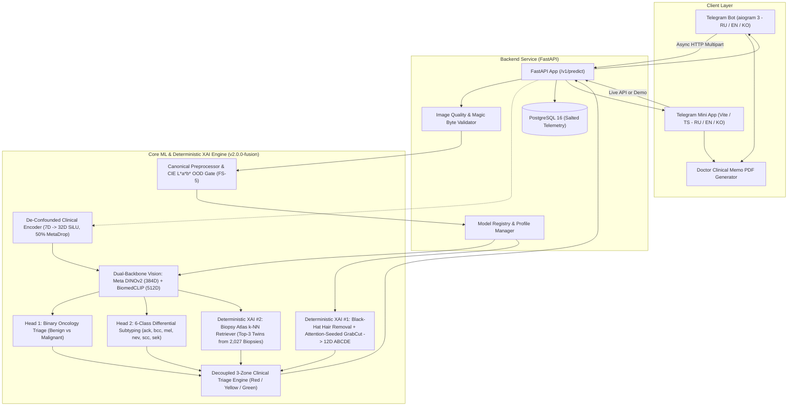

# Architecture Specification: SkinAI

## 1. System Overview
SkinAI is an end-to-end computer vision and clinical decision support research platform for skin lesion classification. It decouples the client tier (Telegram Bot & Telegram Mini App), the service tier (FastAPI Backend), and the core ML engine (ONNX Runtime / PyTorch).



---

## 2. Component Specifications

### 2.1 Telegram Bot (`bot/`)
- **Technology**: Python 3.11+, `aiogram 3.x`.
- **Localization Engine**: Trilingual support across all UI flows, dialogs, keyboards, and clinical nosology names:
  - 🇷🇺 **Russian** (`ru`) — Primary interface language;
  - 🇬🇧 **English** (`en`) — International clinical reference;
  - 🇰🇷 **Korean** (`ko`) — East-Asian clinical reference.
- **Interactive Triage & Anamnesis**:
  - Implements the **Glasgow 7-Point Checklist** (NICE Guideline NG12) via aiogram FSM.
  - Generates an in-memory doctor encounter memo PDF (`bot/services/pdf_report.py`) with zero cognitive anchoring (patient photo, answers, questions for doctor, no model probabilities).
- **Security & Privacy**:
  - Zero raw image retention on disk.
  - Private testing allowlist (`TELEGRAM_ALLOWED_USERS`) to prevent unauthorized access.

### 2.2 Telegram Mini App (`miniapp/`)
- **Technology**: Vite 6, TypeScript, Vanilla CSS design system.
- **Features**:
  - Direct integration with Telegram WebApp SDK (`Telegram.WebApp.ready()`, `expand()`, `HapticFeedback`, `MainButton`).
  - Adaptive Dark/Light theme switching.
  - Interactive Glasgow 7-point checklist progress meter (0/7 to 7/7).
  - ABCD educational cards for patient understanding.
  - In-browser client PDF generation (`jspdf`) with zero cognitive anchoring.

### 2.3 Backend Service (`backend/`)
- **Technology**: Python 3.11+, `FastAPI`, `Pydantic v2`, `SQLAlchemy 2`.
- **Endpoints**:
  - `GET /health`: Readiness and liveness probes (DB ping, model loading check).
  - `GET /v1/profiles`: Metadata on active model profiles, target classes, and release gate status.
  - `POST /v1/predict`: Multipart endpoint accepting image bytes, profile string, and optional Glasgow anamnesis.
- **Input Gating**:
  - Strict magic byte validation (`detect_image_format_from_bytes`) rejecting polyglots and executable scripts.
  - Pillow decompression bomb protection (`Image.MAX_IMAGE_PIXELS = 25_000_000`, max 15 MB).
  - Laplacian variance blur detection (rejects blurry images below threshold 8.0).
- **Telemetry Storage**:
  - PostgreSQL 16 storing salted anonymous client hashes (`HMAC-SHA256(user_id, TELEMETRY_SALT)`), timestamp, predicted class, triage tier, and latency. **No raw photos are ever saved to disk or DB**.
  - Ephemeral execution in `tmpfs` RAM disk (`/tmp:size=2G`).

### 2.4 ML Inference & Decoupled Triage Engine (`ml/`)
- **Foundational Vision Backbone**: Meta DINOv2 Small (`vit_small_patch14_dinov2`, 384-dim L2-normalized embeddings, input resolution 518x518 bicubic or 224x224 letterbox).
- **Tabular Clinical Encoder**: `TabularClinicalEncoder` (12-dim anamnesis vector: normalized age, one-hot anatomical site, one-hot sex, diameter indicator -> 64-dim embedding with learnable missing feature masking).
- **Multimodal Latent Space**: Late fusion layer concatenating vision (384D) and clinical (64D) features into a unified 448D representation with 0.25 dropout.
- **Dual-Head Architecture**:
  - **Head 1 (Binary Oncology Triage)**: 2 logits `[Benign, Malignant]`, trained on all available images with focal loss, providing a high-sensitivity cancer screening gate.
  - **Head 2 (Differential 6-Class Subtyping)**: 6 logits (`ack`, `bcc`, `mel`, `nev`, `scc`, `sek`), trained with `MaskedClassWeightedFocalLoss` (`ignore_index = -1`), decoupling subtyping accuracy from unmapped cohorts.
- **Dual-Head Clinical Consensus**:
  - Computes union risk: $R_{\text{union}} = (P_{\text{H1}} \ge 0.20) \lor (\sum P_{\text{H2}} \ge 0.20)$.
  - In case of diagnostic divergence, oncological safety priority prevents false negatives.
- **Temperature Calibration**: Calibrated via validation NLL optimization on the Development Validation set ($T \approx 1.58$), reducing ECE.
- **Decoupled 4-Tier Clinical Triage Engine**:
  - Replaces naive heuristic multiplication with deterministic clinical arbitration:
    - 🔴 **`URGENT_REFERRAL`**: Triggered if $P(\text{mel}) \ge \tau_{\text{mel}}$ ($0.05$–$0.20$), or Glasgow score $\ge 3$, or any major symptom reported.
    - 🔵 **`ROUTINE_CONSULTATION`**: Triggered if malignancy risk $\sum P(\text{bcc}, \text{scc}, \text{mel}) \ge 0.20$–$0.30$, or Glasgow score is 1–2.
    - 🟢 **`ROUTINE_NO_HIGH_RISK_DETECTED`**: Absence of high-risk indicators. Accompanied by mandatory disclaimer: does not exclude pathology; in-person dermatologist consultation required if lesion is changing.
    - ⚪ **`INCONCLUSIVE_QUALITY`**: Technical flaw in upload (blur, blank, wrong format, OOD).

---

## 3. The Model Artifact Bundle (`v2.0.0-fusion`)
Model checkpoints are distributed as self-contained bundles:
```
artifacts/models/{profile}/
├── model.onnx               # Fast CPU-optimized ONNX vision model
├── fusion_head.onnx      # De-Confounded Dual-Head Fusion (896D + 7D -> 2D Triage + 6D Subtype)
├── fusion_head.pt        # PyTorch De-Confounded Fusion checkpoint
├── biopsy_atlas_index.pt    # 2,027 biopsy-verified reference cases for Top-3 k-NN retrieval
├── best_model.pt            # PyTorch baseline checkpoint weights
└── manifest.yaml            # Complete specification, classes, thresholds & SHA-256
```

### Bundle Manifest (`manifest.yaml`) Schema:
```yaml
profile: smartphone_clinical
version: 2.0.0-fusion
backbone: efficientnet_b0
fusion_head_onnx: fusion_head.onnx
biopsy_atlas_index: biopsy_atlas_index.pt
classes: [bcc, scc, ack, sek, mel, nev]
input_size: [3, 224, 224]
normalization:
  mean: [0.485, 0.456, 0.406]
  std: [0.229, 0.224, 0.225]
thresholds:
  tau_abstain: 0.40
  tau_referral_melanoma: 0.15
fusion_metrics_exp018:
  global_5fold_oof_macro_f1: 0.7161
  oof_triage_roc_auc_with_ack: 0.9453
  oof_triage_roc_auc_no_ack: 0.9917
  stanford_ddi_in_scope_roc_auc: 0.8250
```

---

## 4. API Contract (`POST /v1/predictions`)

### Request:
- Form field `file`: binary image data (JPEG, PNG, WebP)
- Form field `profile`: `"smartphone_clinical"` | `"dermoscopy"`
- Form field `anamnesis` (optional): JSON string of Glasgow 7-point checklist + `patient_age`, `patient_sex`, `anatom_site`

### Response Body Example:
```json
{
  "request_id": "a8f1d2e3-...",
  "profile": "smartphone_clinical",
  "status": "success",
  "predicted_class_id": "nev",
  "predicted_class_name_en": "Melanocytic nevus",
  "predicted_class_name_ru": "Меланоцитарный невус",
  "predicted_class_name_ko": "멜라닌세포 모반",
  "confidence": 0.675,
  "class_probabilities": {
    "bcc": 0.082,
    "scc": 0.015,
    "ack": 0.041,
    "sek": 0.062,
    "mel": 0.025,
    "nev": 0.675
  },
  "melanoma_risk_score": 0.025,
  "referral_recommended": false,
  "latency_ms": 48.2,
  "quality_metrics": {
    "is_valid": true,
    "blur_score": 42.8,
    "width": 750,
    "height": 750
  },
  "abcde_metrics": {
    "asymmetry_shape": 0.142,
    "border_irregularity": 1.38,
    "color_entropy": 2.41,
    "distinct_color_clusters": 2
  },
  "ood_metrics": {
    "skin_pixel_ratio": 0.892,
    "local_noise_mad": 11.4,
    "is_ood_non_skin": false
  },
  "similar_biopsy_cases": [
    {
      "rank": 1,
      "image_id": "PAT_104_175_841.png",
      "subtype_id": "nev",
      "malignancy_label": "Benign",
      "cosine_similarity": 0.9942
    }
  ],
  "triage": {
    "tier": "self_monitoring",
    "triage_zone": "green",
    "referral_recommended": false
  }
}
```
