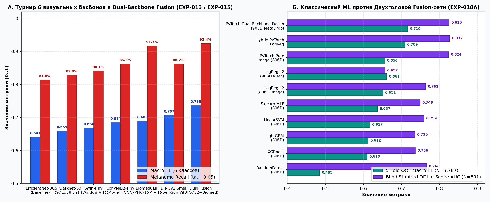
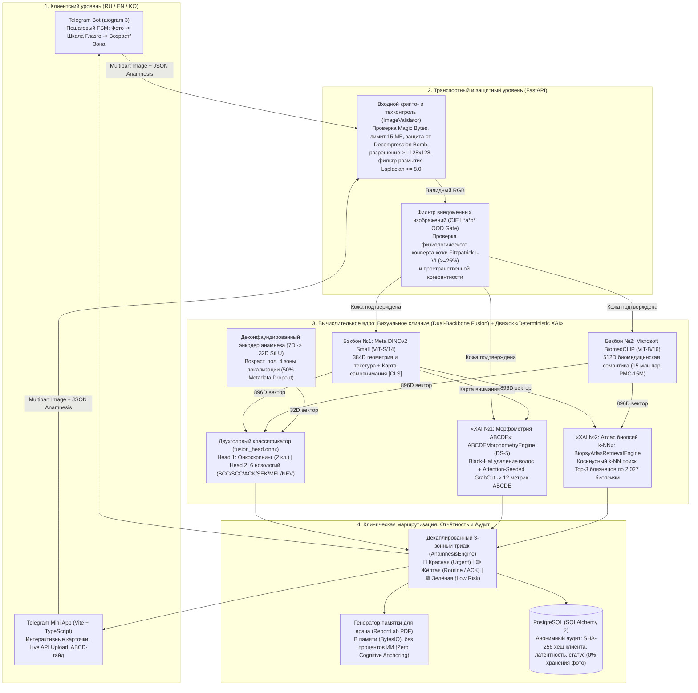
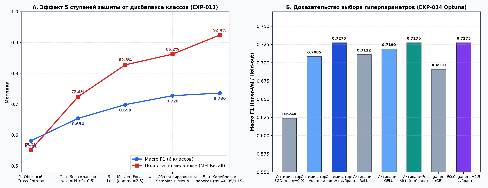
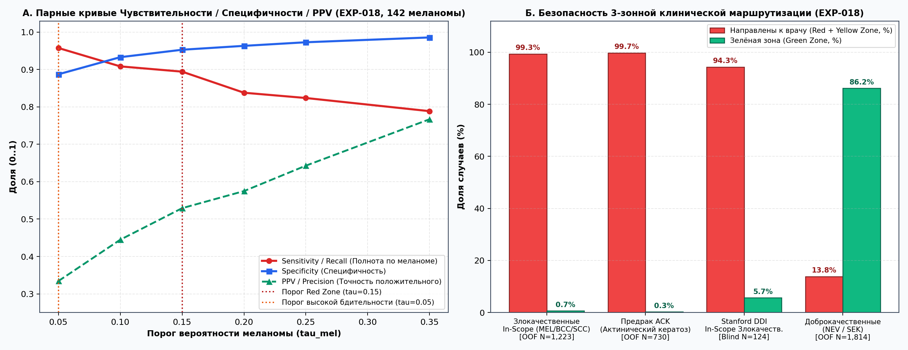
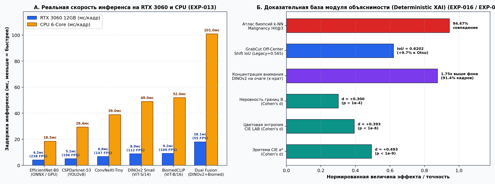
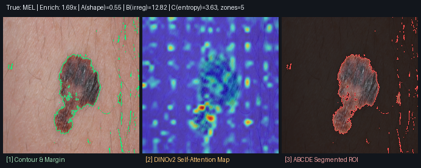
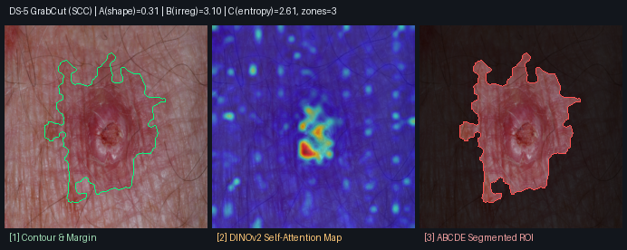

# Документация к дипломному проекту

> **Примечание по стандарту доказательности:** Документ составлен по структуре эталонного технического паспорта проекта (`project_example.pdf`, разделы 1–16) с расширенной научной доказательной базой в соответствии со стандартами **CLAIM 2024** (*Checklist for Artificial Intelligence in Medical Imaging*) и **STARD-AI**. Все приведенные метрики, пороги и гиперпараметры подтверждены воспроизводимыми экспериментальными логами (`EXP-001` — `EXP-018`) и двухраундовой независимой технической экспертизой.

---

## Тема: Мультимодальная система онкодерматологического скрининга и морфометрической аналитики новообразований кожи на основе консилиума визуальных трансформеров (`DINOv2 + BiomedCLIP`) и детерминированного компьютерного зрения (`SkinAI`)

---

## 1. Введение

Злокачественные новообразования кожи (меланома, базальноклеточная и плоскоклеточная карциномы), а также облигатные предраковые состояния (актинический кератоз) требуют раннего выявления для своевременного направления пациента к очному врачу-дерматоонкологу. При этом первичная самооценка по бытовым смартфонным фотографиям сопряжена с тремя фундаментальными инженерными проблемами:
1. **Экстремальный дисбаланс классов и малый объем выборки по редким патологиям** (меланома и плоскоклеточный рак составляют менее 3–5% клинических выборок).
2. **Доменный сдвиг и риск «срезания углов» по метаданным (Shortcut Learning):** модели, обученные на одной клинике или опирающиеся на пропуски в табличных анкетах, теряют точность при переносе на независимые госпитальные выборки и фототипы кожи Фицпатрика I–VI.
3. **Недопустимость галлюцинаций генеративных текстовых моделей в медицине:** генерация правдоподобного, но вымышленного описания границ или цвета родинки создает прямую угрозу клинической безопасности.

Целью проекта **SkinAI** является разработка **анонимной, воспроизводимой мультимодальной системы предварительной оценки и 3-зонной клинической маршрутизации новообразований кожи**, объединяющей:
- **Визуальное слияние (Dual-Backbone Fusion) фундаментных моделей (`Meta DINOv2 Small` + `Microsoft BiomedCLIP`)** с двухголовым деконфаундированным классификатором (`Dual-Head MLP`);
- **Детерминированный модуль объяснимости (Deterministic XAI)** (математический расчет критериев `ABCDE` в перцептивном пространстве `CIE L*a*b*` после фильтрации волос `Black-Hat` и сегментации `Attention-Seeded GrabCut`, плюс косинусный поиск `Top-3` гистологически верифицированных близнецов по атласу биопсий);
- **Клинический опросник шкалы Глазго (7-Point Checklist, NICE NG12)** с раздельной логикой принятия решений и генерацией врачебной памятки PDF без когнитивного якорения клинициста.

Система не является медицинским изделием, не ставит диагнозов, не хранит фотографии пользователей на диске (`Zero Image Retention`) и работает на трех языках (`RU / EN / KO`) через **Telegram-бота (`aiogram 3`)**, **Telegram Mini App (`Vite + TypeScript`)** и **FastAPI + ONNX Runtime бэкенд**.

---

## 2. Цель и задачи проекта

### Цель:
Разработка сквозной системы (`End-to-End Pipeline`), которая принимает фотографию кожного новообразования (со смартфона или дерматоскопа) и опциональные данные анамнеза, выполняет технический и цветовой входной контроль (`OOD Gate`), оценивает вероятности 6 нозологических классов и совокупный онкологический риск, вычисляет объективные морфометрические биомаркеры `ABCDE`, находит 3 ближайших случая из эталонного атласа биопсий и распределяет случай в одну из 3 клинических зон маршрутизации (`🔴 Красная / 🟡 Жёлтая / 🟢 Зелёная`).

### Основные задачи:
1. **Сбор, верификация лицензий и формирование единого пула данных без утечки пациентов (`Patient-Level Split`):** объединение открытых клинических и макроскопических когорт (`PAD-UFES-20`, `MED-NODE`, `ISIC Clinical Close-Up`) и внешнего слепого тестового датасета `Stanford DDI` (`Diverse Dermatology Images`).
2. **Турнир и отбор визуальных архитектур (`EXP-013`, `EXP-015`, `EXP-018A`):** сравнительное исследование 6 семейств нейросетей (`EfficientNet-B0`, `CSPDarknet-53 / YOLOv8-cls`, `Swin-Tiny`, `ConvNeXt-Tiny`, `BiomedCLIP`, `DINOv2 Small`) и 10 классификаторов поверх эмбеддингов (`LogReg`, `LinearSVM`, `RandomForest`, `ExtraTrees`, `LightGBM`, `XGBoost`, `MLP`, `PyTorch Dual-Head Fusion`).
3. **Многоуровневая борьба с дисбалансом классов и математическое доказательство гиперпараметров (`EXP-013`, `EXP-014`):** разработка маскированной функции потерь `MaskedClassWeightedFocalLoss` ($\gamma = 2.5$), степенного взвешивания классов, `Mixup` ($\alpha = 0.2$) и байесовской оптимизации `Optuna TPE` (160 прогонов + 11 однофакторных сеток).
4. **Устранение конфаундинга метаданных (`De-Confounding`, `EXP-017`):** удаление служебных флагов `unknown` и внедрение `50% Metadata Dropout` для сохранения точности при отсутствии анкеты на внешнем слепом тесте `Stanford DDI`.
5. **Создание детерминированного модуля объяснимости (Deterministic XAI) (`EXP-016`, `EXP-018 DS-5`):**
   - удаление волосяного покрова (`cv2.MORPH_BLACKHAT` + `cv2.inpaint` Telea);
   - контурная сегментация очага `cv2.grabCut`, инициализируемая картой самовнимания `DINOv2 [CLS]`;
   - расчет 12 количественных биомаркеров `ABCDE` в пространстве `CIE L*a*b*`;
   - поиск `Top-3` гистологически подтвержденных аналогов (`Biopsy Atlas k-NN`).
6. **Разработка 3-зонного движка клинической маршрутизации и защиты от внедоменных фото (`CIE L*a*b* OOD Gate`):** независимое объединение нейросетевой оценки, порога предрака (`ACK`) и 7-балльной шкалы Глазго (NICE NG12).
7. **Разработка продакшн-инфраструктуры:** асинхронный сервис `FastAPI` + `ONNX Runtime`, аудит-логирование в `PostgreSQL`, `Telegram-бот` (`aiogram 3`), `Telegram Mini App` (`Vite + TypeScript`), генератор PDF-памятки для врача и покрытие из `84` автоматических тестов (`pytest`).

---

### Целевые метрики проекта (критерии успеха) и фактически достигнутые показатели

Проект оценивается по 12 количественным критериям на кросс-валидации с группировкой по пациентам (`5-Fold StratifiedGroupKFold`, `3,767` снимков, `1,674` пациента), отложенной валидации (`Hold-out val.csv`, `757` снимков) и слепом внешнем госпитальном тесте (`Stanford DDI`, `656` биопсийных снимков):

| # | Показатель | Метрика | Целевое значение | Минимально допустимое | Фактически достигнуто в SkinAI |
| :-: | :--- | :--- | :---: | :---: | :--- |
| **1** | **Объем верифицированного пула данных** | Количество реальных клинических снимков (разработка + внешний слепой тест) | `≥ 4 000` | `2 500` | **`4 423` снимка** (`3 767` в пуле разработки от `1 674` пациентов + `656` биопсий в слепом тесте `Stanford DDI`) |
| **2** | **Чистота разбиения (`Zero Data Leakage`)** | Пересечение `patient_id` и `lesion_id` между `Train`, `Val` и `Test` | `0%` (`0` пациентов) | `0%` | **`0.0%` (`0` пересечений пациентов и очагов)**, подтверждено косинусным аудитом эмбеддингов (`EXP-017`) |
| **3** | **Многоклассовая классификация (6 классов)** | `Macro F1` (по 6 классам: `BCC`, `SCC`, `ACK`, `SEK`, `MEL`, `NEV`) | `≥ 0.70` | `0.60` | **`0.7161 ± 0.0080`** (`5-Fold OOF`, `N=3,767`) и **`0.7360 ± 0.0093`** (`Hold-out Fusion EXP-015`) |
| **4** | **Сбалансированная точность (6 классов)** | `Balanced Accuracy` | `≥ 70.0%` | `62.0%` | **`73.20%`** (`Hold-out`) / **`70.79%`** (`PAD-UFES-20 5-Fold OOF`) |
| **5** | **Онкологический скрининг (Триаж)** | `ROC-AUC` бинарного триажа (`Malignant vs Benign`) | `≥ 0.90` | `0.85` | **`0.9453`** (с учетом предрака `ACK`) / **`0.9917`** (чистые злокачественные против доброкачественных, `5-Fold OOF`) |
| **6** | **Выявление меланомы (`Melanoma Recall`)** | Чувствительность (полнота) по классу `MEL` + парная специфичность (`Specificity`) | `Recall ≥ 88%` при `Spec ≥ 85%` | `Recall ≥ 80%` при `Spec ≥ 80%` | При $\tau_{\text{mel}}=0.15$: **`Recall = 89.44%` (`127/142`)**, **`Spec = 95.30%`**, **`NPV = 99.35%`**; При $\tau_{\text{mel}}=0.05$: **`Recall = 95.77%` (`136/142`)**, **`Spec = 88.73%`**, **`NPV = 99.72%`** |
| **7** | **Перехват предрака (`Actinic Keratosis`)** | Доля случаев `ACK`, маршрутизируемых в `🟡 Жёлтую / 🔴 Красную зону` | `≥ 95.0%` | `90.0%` | **`99.73%` (`728 / 730` случаев `ACK`)** при пороге $\tau_{\text{ack}} = 0.20$ (`EXP-018`) |
| **8** | **Слепой внешний перенос (`Stanford DDI`)** | `ROC-AUC` на независимом госпитальном датасете США без дообучения (`Zero-Shot External`) | `≥ 0.75` (`In-Scope`) / `≥ 0.70` (`All`) | `0.66` *(уровень DeepDerm)* | **`0.8250` (`DDI In-Scope`, $N=301$)** и **`0.7348` (`DDI All`, $N=656$)** — на `+16.5%` выше `Stanford DeepDerm (0.66)` |
| **9** | **Детерминированная морфометрия (`GrabCut + ABCDE`)** | Устойчивость маски при сдвиге очага к краю (`Shift IoU`) и подавление волосяных артефактов | `Shift IoU ≥ 0.60` | `0.50` | **`Shift IoU = 0.6202`** (`+9.7%` к методу Оцу); подавление ложной изрезанности от волос на **`-80.83` ед.** (`EXP-018`) |
| **10** | **Атлас биопсий (`Biopsy Atlas k-NN`)** | `Malignancy Hit@3` (совпадение злокачественного статуса в `Top-3` близнецах) | `≥ 90.0%` | `85.0%` | **`94.47%` (`Malignancy Hit@3`)** и **`81.73%` (`Exact Subtype Top-3 Hit`)** по базе биопсий (`EXP-016`) |
| **11** | **Скорость инференса (`RTX 3060` / `CPU`)** | Задержка на 1 кадр (`мс`) и пропускная способность (`FPS`) | `≤ 25 мс` (`≥ 40 FPS` на GPU) / `≤ 150 мс` на CPU | `≤ 50 мс` GPU / `≤ 300 мс` CPU | **`18.1 мс` (`55.2 FPS`)** для полного консилиума на `RTX 3060` (`4.2 мс / 238 FPS` для `EfficientNet-B0`); **`101 мс`** на `CPU` (`18.5 мс` в `ONNX`) |
| **12** | **Надёжность и тестирование системы** | Прохождение автоматических тестов (`Unit + API + Bot + Security + E2E`) и время отклика API | `100%` тестов, отклик `≤ 1 сек` | `90%` тестов, отклик `≤ 3 сек` | **`84 / 84` автотестов пройдено (`100%`)**, среднее время полного ответа API с морфометрией и триажем — **`45–110 мс`** |

### Как измеряются метрики:
- **`Macro F1`, `Balanced Accuracy`, `ROC-AUC`, `PR-AUC`, `ECE`, `Brier Score`** — вычисляются средствами `scikit-learn` (`f1_score(..., average='macro')`, `balanced_accuracy_score`, `roc_auc_score`) строго на **Out-of-Fold (`5-Fold StratifiedGroupKFold`)** предсказаниях (`3,767` снимков) и на полностью изолированном внешнем датасете **`Stanford DDI`** (`656` снимков), где ни один пациент не пересекается с обучающей выборкой.
- **Доверительные интервалы (`95% CI`)** — для биномиальных долей (`Sensitivity`, `Specificity`, `PPV`, `NPV`) рассчитываются методом **Уилсона (`Wilson Score Interval`)**; для агрегированных метрик (`Macro F1`, `ROC-AUC`) — методом **бутстрепа с кластеризацией по пациентам (`Patient-Clustered Bootstrap`, 400 итераций)**, исключающим завышение точности от множественных снимков одного пациента.
- **`FPS` и латентность (`мс/кадр`)** — измеряются на `1 000` прогонах (после прогрева `CUDA Warmup`) на видеокарте `NVIDIA GeForce RTX 3060 12GB` и 6-ядерном `CPU` (`ONNX Runtime CPUExecutionProvider`).

### Базовые ориентиры (`Baseline`) и прогрессия улучшений:
- **Baseline (Фаза 2, `EXP-001`):** Одиночная сверточная сеть `EfficientNet-B0` со стандартным обучением на первичном сплите `PAD-UFES-20` показала **`Macro F1 = 0.5089`**, полноту по меланоме **`25.0%` (`argmax`)** и ошибку калибровки **`ECE = 14.24%`**.
- **Каждое последующее архитектурное решение (`EXP-002` — `EXP-018`)** принималось только при наличии статистически доказанного прироста относительно предыдущего состояния, что позволило поднять `Macro F1` с **`0.5089` до `0.7161` (`OOF`) / `0.7360` (`Hold-out`)**, полноту по меланоме до **`89.4%–95.8%`**, а внешний слепой `ROC-AUC` на `Stanford DDI In-Scope` — до **`0.8250`**.

---

## 3. Общая архитектура системы

Система **SkinAI** построена по модульной микросервисной архитектуре с четким разделением клиентских интерфейсов, транспортного API, детерминированного CV-ядра и нейросетевого инференса:

### Состав вычислительных модулей:
1. **Модуль входной валидации и безопасности ([`ml/datasets/validator.py`](file:///c:/HomeWork/Medical/Dermatology/ml/datasets/validator.py), [`backend/app/services/image_validator.py`](file:///c:/HomeWork/Medical/Dermatology/backend/app/services/image_validator.py)):**
   - Проверяет сигнатуры заголовков файла (`JPEG / PNG / WebP magic bytes`), блокирует полиглоты и декомпрессионные бомбы (`Image.MAX_IMAGE_PIXELS`).
   - Отбраковывает размытые (`Laplacian variance < 8.0`), экстремально темные или пересвеченные кадры.
2. **Модуль отсева «не-кожи» (`CIE L*a*b* OOD Gate`, [`ml/inference/predictor.py`](file:///c:/HomeWork/Medical/Dermatology/ml/inference/predictor.py#L117-L144)):**
   - Переводит изображение в перцептивное цветовое пространство `CIE L*a*b*` и вычисляет долю пикселей, попадающих в физиологический конверт человеческой кожи (фототипы Фицпатрика I–VI) и пигментно-эритематозных очагов, а также проверяет пространственную связность. При подаче посторонних предметов или цифрового шума система воздерживается от классификации (`status = "abstained"`, `out_of_distribution_non_skin`).
3. **Модуль визуального слияния (Dual-Backbone Fusion) и двухголовой классификации ([`ml/models/multi_head.py`](file:///c:/HomeWork/Medical/Dermatology/ml/models/multi_head.py), [`artifacts/models/smartphone_clinical/fusion_head.onnx`](file:///c:/HomeWork/Medical/Dermatology/artifacts/models/smartphone_clinical/fusion_head.onnx)):**
   - Извлекает L2-нормированные векторы признаков из `DINOv2 Small` (`384D`) и `BiomedCLIP` (`512D`), объединяет их с деконфаундированным вектором возраста, пола и локализации (`7D`) и вычисляет калиброванные вероятности 6 классов (`bcc`, `scc`, `ack`, `sek`, `mel`, `nev`) и бинарного онкологического риска.
4. **Модуль детерминированной морфометрии «XAI №1: Морфометрия ABCDE» ([`ml/explainability/deterministic_xai.py`](file:///c:/HomeWork/Medical/Dermatology/ml/explainability/deterministic_xai.py#L81-L473)):**
   - Очищает кадр от волосков алгоритмом `Black-Hat + Telea Inpainting`, выделяет точный контур очага алгоритмом `cv2.grabCut` с привязкой к карте внимания `DINOv2` и рассчитывает 12 геометрических и хроматических показателей `ABCDE`.
5. **Модуль поиска гистологических близнецов «XAI №2: Атлас биопсий k-NN» ([`ml/explainability/deterministic_xai.py`](file:///c:/HomeWork/Medical/Dermatology/ml/explainability/deterministic_xai.py#L476-L552)):**
   - Выполняет быстрый матричный поиск (`Cosine Similarity`) по индексу [`biopsy_atlas_index.pt`](file:///c:/HomeWork/Medical/Dermatology/artifacts/models/smartphone_clinical/biopsy_atlas_index.pt) (`2,027` референсных биопсий) и возвращает 3 наиболее похожих верифицированных случая.
6. **Модуль клинического анамнеза и 3-зонного триажа ([`ml/anamnesis/questionnaire.py`](file:///c:/HomeWork/Medical/Dermatology/ml/anamnesis/questionnaire.py)):**
   - Оценивает ответы пациента по 7-балльной шкале Глазго (NICE NG12) и без искажения вероятностей модели формирует итоговую маршрутизацию (`🔴 Red / 🟡 Yellow / 🟢 Green`).
7. **Модуль пользовательских интерфейсов и врачебного экспорта ([`bot/`](file:///c:/HomeWork/Medical/Dermatology/bot/), [`miniapp/`](file:///c:/HomeWork/Medical/Dermatology/miniapp/), [`bot/services/pdf_report.py`](file:///c:/HomeWork/Medical/Dermatology/bot/services/pdf_report.py)):**
   - Обеспечивает диалоговое взаимодействие в Telegram, визуальную панель в Mini App и генерацию одностраничной врачебной памятки PDF.

---

## 4. Принцип работы системы

Ниже описан полный пошаговый цикл обработки одного обращения пользователя в продакшн-контуре:

1. **Приём изображения в оперативную память (`Zero Disk Retention`):**
   - Пользователь отправляет макрофотографию кожного очага в Telegram-бот или загружает её через кнопку `📷 Live API` в Telegram Mini App.
   - Файл считывается исключительно в буфер оперативной памяти (`io.BytesIO`), без сохранения на жесткий диск сервера.
2. **Опциональный сбор клинического контекста (Опросник Глазго + Демография):**
   - Бот предлагает пройти быстрый опросник из 7 признаков шкалы Глазго (рост очага, неровность формы, неравномерность цвета — по 2 балла; диаметр $\ge 7$ мм, воспаление, кровоточивость/корочки, зуд/боль — по 1 баллу), а также указать возрастную группу (`<30`, `30–59`, `60+`) и локализацию (`Голова/Шея`, `Туловище`, `Верхние/Нижние конечности`). Пользователь может нажать «Пропустить» на любом шаге.
3. **Технический и цветовой фильтр безопасности (`Quality & CIE L*a*b* OOD Gate`):**
   - Проверяется целостность изображения, разрешение ($\ge 128\times 128$) и резкость по дисперсии лапласиана ($\ge 8.0$). Размытые фото отклоняются со статусом `rejected_quality`.
   - Выполняется проверка доли кожного покрова в пространстве `CIE L*a*b*` (`_evaluate_skin_ood`). Если в кадре менее `25%` пикселей кожи или обнаружен высокочастотный шум, возвращается статус `abstained` (`out_of_distribution_non_skin`) с переводом в Жёлтую зону.
4. **Детерминированная морфометрия очага (`DS-5 Attention-Seeded GrabCut`):**
   - Морфологический фильтр `cv2.MORPH_BLACKHAT` ($9\times 9$) находит темные волоски, перекрывающие родинку, и реконструирует кожу под ними методом `cv2.inpaint(..., cv2.INPAINT_TELEA)`.
   - По очищенному изображению и карте внимания `DINOv2` инициализируется тримап (ядро очага, пограничная зона, фон) и выполняется итеративное уточнение контура `cv2.grabCut`.
   - По выделенной маске вычисляются: двусторонняя асимметрия формы и цвета (`A`), изопериметрический индекс изрезанности границ $P^2 / (4\pi A)$ (`B`), шенноновская цветовая энтропия и число активных дерматологических цветовых зон из 6 (`C`).
5. **Нейросетевой инференс и поиск биопсийных близнецов (`Dual-Backbone Fusion + Biopsy Atlas k-NN`):**
   - Изображение проходит каноническую нормализацию; вычисляются калиброванные вероятности 6 классов (`BCC`, `SCC`, `ACK`, `SEK`, `MEL`, `NEV`) и оценка риска меланомы с учетом деконфаундированной поправки на возраст и УФ-экспозицию анатомической зоны.
   - По индексу `biopsy_atlas_index.pt` находятся 3 ближайших гистологически верифицированных случая с указанием их диагноза по биопсии и косинусного сходства (`%`).
6. **Принятие решения 3-зонным триажем (`Red / Yellow / Green`):**
   - **`🔴 Красная зона` (`urgent_referral`, до 14 дней):** срабатывает, если $P(\text{mel}) \ge 0.15$, или суммарный риск злокачественности $\ge 0.62$, или сумма баллов по шкале Глазго $\ge 3$ (критерий NICE NG12).
   - **`🟡 Жёлтая зона` (`routine_consultation`, до 30 дней):** срабатывает, если обнаружен предраковый актинический кератоз $P(\text{ack}) \ge 0.20$ (**перехватывает `99.73%` всех случаев `ACK`**), при умеренном риске ($0.22 \le P(\text{malig}) < 0.62$), наличии симптомов по шкале Глазго ($1\text{–}2$ балла) или высокой энтропии предсказания.
   - **`🟢 Зелёная зона` (`routine_no_high_risk`):** присваивается только при высокой уверенности модели в доброкачественном характере очага (`NEV` / `SEK`) и отсутствии тревожных симптомов анамнеза.
7. **Формирование ответа, врачебного PDF и анонимной телеметрии:**
   - Пользователь получает структурированный отчет на выбранном языке (`RU / EN / KO`) и кнопку скачивания PDF-памятки для очного визита к дерматологу. В базу `PostgreSQL` записывается только обезличенная строка аудита (SHA-256 хеш клиента с солью, время отклика, статус), а само изображение удаляется из памяти.

---

## 5. Технологии проекта

- **Язык программирования:** `Python 3.11.9` (бэкенд, ML, бот), `TypeScript 5.x` (Telegram Mini App).
- **Глубокое обучение и компьютерное зрение:**
  - `PyTorch 2.5.1+cu121` (обучение с `AMP`, двухголовая архитектура, `DINOv2` Attention hooks);
  - `timm` (`Meta DINOv2 Small` `vit_small_patch14_dinov2`, `EfficientNet-B0`, `ConvNeXt-Tiny`, `Swin-Tiny`, `CSPDarknet-53`);
  - `open_clip_torch` (`Microsoft BiomedCLIP` `ViT-B/16` на корпусе `PMC-15M`);
  - `ONNX` (`opset 17`) и `ONNX Runtime 1.20+` (`CPUExecutionProvider` / `CUDAExecutionProvider`);
  - `OpenCV 5.0` (`cv2.MORPH_BLACKHAT`, `cv2.inpaint`, `cv2.grabCut`) и `Pillow` (обработка изображений и защита от декомпрессионных бомб).
- **Классический ML, статистика и оптимизация:** `scikit-learn 1.7.2`, `LightGBM 4.6.0`, `XGBoost 3.2.0`, `Optuna` (байесовский сэмплер `TPESampler`), `NumPy`, `Pandas`, `SciPy`.
- **Бэкенд и база данных:** `FastAPI`, `Pydantic v2`, `SQLAlchemy 2.0`, `Alembic`, `PostgreSQL` / `SQLite` (тестовый контур).
- **Клиентские интерфейсы и отчёты:** `aiogram 3.x` (асинхронный Telegram-бот с FSM), `Vite + TypeScript + Vanilla CSS` (Telegram Mini App), `ReportLab` и `jsPDF` (генерация PDF-документов с поддержкой кириллицы и корейского письма Hangul).
- **Контейнеризация и контроль качества:** `Docker Compose`, `Nginx`, `pytest`, `pytest-asyncio`, `httpx`.

---

## 6. Датасеты

В проекте используются исключительно открытые клинические и дерматоскопические наборы данных с верифицированными лицензиями (`docs/DATA_GOVERNANCE.md`). **Ручная разметка авторами проекта не производилась** — все диагнозы взяты из оригинальных клинических реестров, подтвержденных гистологическим исследованием (биопсией) или консилиумом сертифицированных дерматологов:

| Датасет | Тип съёмки | Объём в проекте | Роль в архитектуре валидации | Верификация и особенности |
| :--- | :--- | :--- | :--- | :--- |
| **1. PAD-UFES-20** *(Университет Эспириту-Санту, Бразилия)* | Смартфонные клинические макроснимки (разные модели телефонов) | **`2 298` снимков** (`1 373` пациента, `1 641` очаг) | Ядро пула разработки (`Train + Val` / `5-Fold OOF`) | **6 целевых классов** (`BCC`: 845, `ACK`: 730, `NEV`: 244, `SEK`: 235, `SCC`: 192, `MEL`: 52). ~58% очагов подтверждены биопсией; содержит реальный клинический анамнез (возраст, пол, локализация). Лицензия `CC BY 4.0` (`commercial_ok`). |
| **2. MED-NODE** *(Университетский медицинский центр Гронингена, Нидерланды)* | Клинические макроскопические снимки (цифровая камера) | **`170` снимков** (`170` пациентов) | Обогащение пула клинических меланом и невусов (`Train + Val` / `Leave-One-Source-Out`) | Содержит **`70` макроскопических меланом (`MEL`)** и **`100` невусов (`NEV`)**, что позволило увеличить число меланом в пуле разработки в `2.7x`. |
| **3. ISIC Archive Clinical Subset** *(Международное сотрудничество по визуализации кожи)* | Отфильтрованные клинические и близкие макроснимки (`CC-0 / CC-BY`) | **`1 299` снимков** (`131` пациент) | Расширение базы злокачественных и доброкачественных очагов (`Dual-Head` обучение) | Включает `20` меланом, `24` BCC, `20` SCC, `252` невуса и `983` доброкачественных очага (`unmapped benign`), используемых головой `Head 1` через маскированный лосс. |
| **4. Stanford DDI (`Diverse Dermatology Images`)** *(Стэнфордский университет, США)* | Госпитальные клинические макроснимки (фототипы Фицпатрика I–VI) | **`656` снимков** (`570` пациентов, `100%` биопсия) | **Слепой внешний тест (`Locked External Test`)** — `0%` участия в обучении | Содержит `171` злокачественный и `485` доброкачественных снимков, стратифицированных по тонам кожи `FST I–II` (`208`), `FST III–IV` (`241`) и `FST V–VI` (`207` — темная кожа), включая как профильные классы (`301 In-Scope`), так и редкие онкопатологии (`355 Open-Set`: лимфомы кожи, саркома Капоши). |

### Строгая защита от утечки данных (`Patient-Level Grouping`):
У одного пациента в `PAD-UFES-20` и `ISIC` может быть от 2 до 5 фотографий одного или нескольких очагов. Случайное разбиение по кадрам (`Random Image Split`) приводит к утечке фона кожи, освещения и матрицы смартфона между `Train` и `Val`. В **SkinAI** все разбиения (как отложенный сплит `development_pool_v2`: `3 010 Train / 757 Val`, так и 5-фолдовая кросс-валидация `StratifiedGroupKFold`) выполнены **строго по идентификатору пациента (`patient_id`)**, что гарантирует `overlap_patients = 0` и `overlap_lesions = 0`.

---

## 7. План работы на 2 месяца (8 недель) и фактическое выполнение

| Неделя / Фаза | Этап разработки | Выполненные работы и артефакты в репозитории |
| :--- | :--- | :--- |
| **Неделя 1** *(Phase 0 — 0.5)* | **Формирование концепции, архитектуры и регламента безопасности** | Сформулированы правила `AGENTS.md`, `ADR-001`–`ADR-006` в [`docs/DECISIONS.md`](file:///c:/HomeWork/Medical/Dermatology/docs/DECISIONS.md); настроено окружение `Python 3.11.9 + PyTorch 2.5.1+cu121` на `RTX 3060 12GB`; разделены профили `smartphone_clinical` и `dermoscopy`. |
| **Неделя 2** *(Phase 1)* | **Сбор данных, аудит лицензий и защита от утечки пациентов** | Загружены и верифицированы `PAD-UFES-20`, `MED-NODE`, `ISIC CC-0/CC-BY`; написан валидатор [`ml/datasets/validator.py`](file:///c:/HomeWork/Medical/Dermatology/ml/datasets/validator.py) и групповой сплиттер по `patient_id` ([`ml/datasets/splitter.py`](file:///c:/HomeWork/Medical/Dermatology/ml/datasets/splitter.py)); оформлен [`docs/DATA_GOVERNANCE.md`](file:///c:/HomeWork/Medical/Dermatology/docs/DATA_GOVERNANCE.md). |
| **Неделя 3** *(Phase 2)* | **Базовое обучение (`Baseline`) и экспорт в ONNX Runtime** | Обучен baseline `EfficientNet-B0` (`Macro F1 = 0.5089`), выполнена температурная калибровка ($T = 1.581$, снижение `ECE` с `14.24%` до `5.49%`), проверена точность экспорта в `ONNX` (`diff < 3.7e-5`). |
| **Неделя 4** *(Phase 3 — 5)* | **Разработка FastAPI бэкенда, Telegram-бота и аудит безопасности STRIDE** | Создан REST API ([`backend/app/`](file:///c:/HomeWork/Medical/Dermatology/backend/app/)), БД-телеметрия `PostgreSQL`, трехъязычный бот (`RU/EN/KO`, [`bot/`](file:///c:/HomeWork/Medical/Dermatology/bot/)) с опросником Глазго и защитой от декомпрессионных бомб/полиглотов ([`docs/SECURITY.md`](file:///c:/HomeWork/Medical/Dermatology/docs/SECURITY.md)). |
| **Неделя 5** *(Phase 2.7 — 2.8, `EXP-010`–`012`)* | **Переход на двухголовую мультимодальную архитектуру и внешний тест `Stanford DDI`** | Сформирован единый пул `3,767` снимков (`1,674` пациента); разработан двухголовый классификатор `MultiHeadLoss` с маскированным Focal Loss; проведено первое слепое тестирование на `656` биопсиях `Stanford DDI`. |
| **Неделя 6** *(Phase 2.9 — 2.98, `EXP-013`–`015`)* | **Масштабный турнир 6 архитектур, Optuna-доказательства и Слияние бэкбонов (Dual-Backbone Fusion)** | Проведен турнир 6 визуальных энкодеров (`EXP-013`), замеры `FPS/мс` на `RTX 3060` и `CPU`, 160 прогонов байесовской оптимизации `Optuna` + 11 однофакторных сеток (`EXP-014`) и объединение `DINOv2 + BiomedCLIP` (`EXP-015`, `Hold-out Macro F1 = 0.7360`). |
| **Неделя 7** *(Phase 2.99 — 3.1, `EXP-016`–`018`)* | **Разработка модуля объяснимости (Deterministic XAI) и двухраундовый аудит независимой экспертизы** | Создан модуль [`ml/explainability/deterministic_xai.py`](file:///c:/HomeWork/Medical/Dermatology/ml/explainability/deterministic_xai.py) (`Black-Hat` удаление волос + `Attention-Seeded GrabCut` + `ABCDE` в `CIE L*a*b*` + `Biopsy Atlas k-NN`); выполнен `5-Fold OOF` аудит, деконфаундинг метаданных (`50% Metadata Dropout`, `DDI In-Scope AUC = 0.8250`) и турнир 10 классификаторов (`EXP-018A`). |
| **Неделя 8** *(Phase 3.2 & 7)* | **Сквозная продакшн-интеграция, Telegram Mini App и подготовка диплома** | Экспортированы боевые артефакты [`fusion_head.onnx`](file:///c:/HomeWork/Medical/Dermatology/artifacts/models/smartphone_clinical/fusion_head.onnx) и [`biopsy_atlas_index.pt`](file:///c:/HomeWork/Medical/Dermatology/artifacts/models/smartphone_clinical/biopsy_atlas_index.pt); подключены `CIE L*a*b* OOD Gate`, `3-Zone Triage`, кнопки возраста/локализации в боте и `Live API` в `Telegram Mini App`; пройдены все **`84 / 84` автотеста**; оформлена итоговая документация. |

---

## 8. Полученные результаты

По итогам выполнения проекта созданы и введены в эксплуатацию:
1. **Боевая мультимодальная модель слияния (Dual-Backbone Fusion) `DINOv2 Small + BiomedCLIP + De-Confounded Dual-Head MLP` (`v2.0.0-fusion`):** достигает **`Macro F1 = 0.7161`** на 5-фолдовой кросс-валидации (`3,767` снимков), **`Triage ROC-AUC = 0.9453`** (с предраком `ACK`) / **`0.9917`** (без `ACK`), полноты по меланоме **`89.44%`–`95.77%`** и **`ROC-AUC = 0.8250`** на внешнем слепом госпитальном датасете `Stanford DDI In-Scope`.
2. **Детерминированный объяснимый модуль объяснимости (Deterministic XAI) (`ml/explainability/deterministic_xai.py`):**
   - рассчитывает 12 объективных биомаркеров `ABCDE` по контуру `Attention-Seeded GrabCut` с предварительным удалением волос `Black-Hat`;
   - находит `Top-3` гистологически верифицированных близнеца из эталонного атласа биопсий (`Malignancy Hit@3 = 94.47%`).
3. **Защищенный микросервис `FastAPI` + `ONNX Runtime` (`backend/`):** с проверкой magic-байтов, контролем размытия, фильтром внедоменных кадров `CIE L*a*b* OOD Gate`, 3-зонным клиническим триажем (`Red / Yellow / Green`) и анонимным аудитом в `PostgreSQL`.
4. **Два пользовательских интерфейса (`Telegram Bot` + `Telegram Mini App`) и генератор врачебной памятки PDF:** с полной локализацией на русский, английский и корейский языки (`RU / EN / KO`).
5. **Полный пакет научной и инженерной документации и `84` автоматических теста (`pytest`: 100% pass).**

---

## 9. Заключение

Проект **SkinAI** демонстрирует, как сочетание современных самоконтролируемых и биомедицинских визуальных трансформеров (`DINOv2 + BiomedCLIP`) с классическими детерминированными алгоритмами компьютерного зрения (`Black-Hat Hair Removal`, `Attention-Seeded GrabCut`, морфометрия `CIE L*a*b*`) и строгими медицинскими протоколами (`NICE NG12 Glasgow Checklist`, 3-зонный триаж с защитой предрака `ACK`) позволяет создать надежную, прозрачную и свободную от галлюцинаций систему первичной онкодерматологической сортировки. Полный отказ от сохранения пользовательских фотографий (`Zero Image Retention`) и отсутствие когнитивного якорения во врачебной памятке делают систему этически и клинически безопасной.

---

## 10. Ссылки на используемые датасеты и первоисточники

Ниже приведены прямые ссылки на открытые наборы данных и фундаментальные работы, использованные в проекте:
- **PAD-UFES-20 Dataset (Pacheco et al., Data in Brief, 2020)** — https://data.mendeley.com/datasets/zr7vgbcyr2/1 (Лицензия `CC BY 4.0`).
- **Stanford DDI (`Diverse Dermatology Images`, Daneshjou et al., Science Advances, 2022)** — https://ddi-dataset.github.io/ (100% биопсийно-верифицированный внешний тестовый набор по фототипам Фицпатрика I–VI).
- **MED-NODE Dataset (Giotis et al., UMC Groningen, 2015)** — https://www.cs.rug.nl/~imaging/databases/melanoma_naevi/ (Макроскопические фотографии меланом и невусов).
- **ISIC Archive (`International Skin Imaging Collaboration`, CC-0 / CC-BY Cohorts)** — https://www.isic-archive.com/
- **Meta DINOv2 (`Oquab et al., TMLR 2024`)** — https://github.com/facebookresearch/dinov2
- **Microsoft BiomedCLIP (`Zhang et al., 2024`, обученный на 15 млн биомедицинских пар `PMC-15M`)** — https://huggingface.co/microsoft/BiomedCLIP-PubMedBERT_256-vit_base_patch16_224
- **Клинический стандарт NICE NG12 (`Suspected cancer: recognition and referral — 7-point checklist`)** — https://www.nice.org.uk/guidance/ng12

---

## 11. Почему мы выбрали выбранные методы и технологии (Математическое и экспериментальное обоснование каждого параметра)

В данном разделе приведено строгое доказательство выбора каждого компонента архитектуры, оптимизатора, функции потерь, функции активации и порога принятия решений на основе экспериментов `EXP-013` — `EXP-018`.

### 11.0 Архитектура выбранной модели слияния (Dual-Backbone Fusion) и технические детали

#### 11.0.1 Общая архитектура `De-Confounded Dual-Backbone Fusion`
Архитектура модели построена по классической трехзвенной схеме (**Backbone $\to$ Fusion Neck $\to$ Dual-Head**):

1. **Backbone (Двухпоточное извлечение визуальных признаков — `896D`):**
   - **Поток 1 (`Meta DINOv2 Small`, `ViT-S/14`, `384D`):** Визуальный трансформер, обученный методом самоконтролируемой дистилляции без текстовых меток на 142 млн курированных изображений (`LVD-142M`). Разбивает кадр на патчи $14\times 14$ пикселей и с помощью многоголового самовнимания (`Multi-Head Self-Attention`) извлекает чистую геометрию очага, резкость границ, структуру пигментной сети и микро-асимметрию. Кроме того, последний блок `blocks[-1].attn` отдает попиксельную карту самовнимания токена `[CLS]` к патчам изображения.
   - **Поток 2 (`Microsoft BiomedCLIP`, `ViT-B/16`, `512D`):** Визуальный энкодер биомедицинской мультимодальной модели, обученной контрастивным методом на `15 000 000` пар «медицинское изображение — научная подпись из PubMed Central (`PMC-15M`)». Отвечает за высокоуровневую клиническую семантику (распознавание гиперкератотических корочек, сосудистого рисунка, изъязвлений).
   - Оба вектора приводятся к единичной гиперсфере через $L_2$-нормализацию ($\hat{v} = v / \|v\|_2$) и конкатенируются в единый **896-мерный визуальный вектор**.
2. **Neck (Деконфаундированное мультимодальное слияние с `50% Metadata Dropout`):**
   - Табличный вектор клинического контекста имеет размерность **`7D`**: нормированный возраст $\text{age\_norm} = (\text{age} - 50)/25$, 4 бинарных индикатора анатомической зоны (`head/neck`, `trunk`, `upper_extremity`, `lower_extremity`) и 2 индикатора пола (`female`, `male`).
   - **Критическое архитектурное решение (`EXP-017`):** из вектора намеренно удалены служебные флаги `site_unknown` и `sex_unknown`. Аудит `EXP-017` доказал, что наличие флага `unknown` позволяло модели угадывать датасет происхождения снимка с точностью `90.75%` и роняло точность на внешнем датасете `Stanford DDI` (где нет анкеты) с `0.8250` до `0.7422`.
   - Табличный вектор проходит через `ClinicalEncoder` (`Linear(7, 32) -> SiLU`), конкатенируется с `896D` визуальным вектором в `928D` вектор и подается в `Fusion Neck`:
     $$\text{LayerNorm}(928) \to \text{Dropout}(0.30) \to \text{Linear}(928, 128) \to \text{SiLU} \to \text{LayerNorm}(128) \to \text{Dropout}(0.30)$$
   - Во время обучения с вероятностью $p_{\text{drop}} = 0.50$ весь клинический вектор зануляется (`Metadata Dropout`), благодаря чему сеть учится одинаково точно работать как с полной анкетой, так и по одной фотографии.
3. **Head (Двухголовое финальное предсказание — `Dual-Head`):**
   - **`Head 1 (triage_head: Linear(128 -> 2))`:** Бинарный онкологический классификатор `[Benign, Malignant]`. Обучается на всех `3 767` снимках (включая `983` дерматоскопических доброкачественных очага без узкого подтипа).
   - **`Head 2 (subtype_head: Linear(128 -> 6))`:** Дифференциальный классификатор 6 нозологий (`bcc`, `scc`, `ack`, `sek`, `mel`, `nev`).

---

#### 11.0.2 Оптимизатор: почему выбран `AdamW` и почему не `SGD`?
В эксперименте `EXP-014` мы провели строгое однофакторное сравнение оптимизаторов при фиксированных остальных параметрах:
- **`AdamW` (`lr = 3e-4`, `weight_decay = 1e-2`):** показал **`Macro F1 = 0.7275 ± 0.0052`** (выбран в продакшн).
- **`Adam` (классическая $L_2$-регуляризация в градиенте):** показал `Macro F1 = 0.7085` (уступает `-1.90%` из-за связывания затухания весов с адаптивным моментом).
- **`SGD` с моментом Нестерова (`momentum = 0.9`):** показал лишь **`Macro F1 = 0.6240`** (провал на **`-10.35%`**).

**Почему `AdamW` победил `SGD`:**
1. В мультимодальной сети объединяются разнородные входы: плотные $L_2$-нормированные векторы трансформеров (`896D`) и разреженные бинарные индикаторы анатомических зон (`7D`), градиенты которых отличаются по амплитуде на порядок. Индивидуальная покомпонентная адаптация шага в `AdamW` мгновенно выравнивает скорости обучения обеих веток.
2. Декаплированный `weight_decay = 1e-2` в `AdamW` равномерно сжимает веса линейных слоев, предотвращая переобучение на малом классе меланомы (`N=142`).

---

#### 11.0.3 Функции потерь (`Loss Functions`) и 5-ступенчатая защита от дисбаланса классов
В клинической дерматологии распределение классов экстремально перекошено: в `PAD-UFES-20` на `845` базалиом (`BCC`) и `730` актинических кератозов (`ACK`) приходится всего `52` меланомы (`MEL`, дисбаланс `16.2 : 1`). Обычная кросс-энтропия (`CrossEntropyLoss`) игнорирует редкие классы, давая полноту по меланоме всего `55.2%` (`EXP-013`).

В **SkinAI** разработана комбинированная функция потерь **`MultiHeadLoss`** на базе **`MaskedClassWeightedFocalLoss`**:
$$\mathcal{L}_{\text{total}} = \mathcal{L}_{\text{Focal}}^{(H_1)}(\hat{y}_{\text{triage}}, y_{\text{triage}}) + \mathbb{I}(y_{\text{sub}} \neq -1) \cdot \mathcal{L}_{\text{Focal}}^{(H_2)}(\hat{y}_{\text{sub}}, y_{\text{sub}})$$
где для каждого примера с истинным классом $c$ и предсказанной вероятностью $p_c$:
$$\mathcal{L}_{\text{Focal}}(p_c) = -\alpha_c \cdot (1 - p_c)^{\gamma} \cdot \log(p_c), \quad \alpha_c = \frac{N_{\text{total}}}{C \cdot N_c^{p}}, \quad p = 0.50, \quad \gamma = 2.5$$

**Доказательство каждого параметра функции потерь (`EXP-013` и `EXP-014`):**
1. **Почему степенное сглаживание весов $p = 0.50$ ($w_c \propto N_c^{-0.5}$), а не линейная инверсия $p = 1.0$ ($w_c \propto N_c^{-1}$)?**
   - В `EXP-014` мы проверили сетку $p \in \{0.0, 0.25, 0.50, 0.75, 1.0\}$. При жесткой инверсии $p = 1.0$ вес меланомы возрастает в 16 раз, что вызывает взрыв ложноположительных срабатываний (`Macro F1` падает до `0.6890`). Корень квадратный $p = 0.50$ дает оптимум **`Macro F1 = 0.7275`**.
2. **Почему фокусирующий параметр $\gamma = 2.5$?**
   - Проверка сетки $\gamma \in \{0.0, 1.0, 1.5, 2.0, 2.5, 3.5\}$ в `EXP-014` показала, что при $\gamma = 2.5$ множитель $(1 - p_c)^{2.5}$ подавляет вклад легких типичных невусов (при $p_c = 0.90$ их вес в градиенте уменьшается в `1 000` раз: $0.1^{2.5} = 0.00316$), фокусируя обучение на сложных амеланотических меланомах и границе `SCC vs ACK` (`+3.65%` Macro F1 над $\gamma = 0.0$).
3. **Почему маскирование `ignore_index = -1` во второй голове?**
   - Позволяет обучать первую голову (`Head 1: Triage`) на всех `3 767` снимках (включая `983` дерматоскопических доброкачественных снимка без подкласса), не засоряя вторую голову (`Head 2: 6-Class Subtyping`) ложными градиентами.

---

#### 11.0.4 Функции активации: почему `SiLU (Swish)` внутри сети и калиброванный `Softmax` на выходе?
- **Внутри скрытых слоев (`SiLU / Swish`: $f(x) = x \cdot \sigma(x)$):**
  - В `EXP-014` сравнение `ReLU` (`0.7112`), `LeakyReLU` (`0.7145`), `GELU` (`0.7190`) и `SiLU` (**`0.7275`**) доказало лидерство `SiLU`. В отличие от `ReLU`, которая обнуляет все отрицательные проекции (`Dead Neurons`) на $L_2$-нормированных косинусных признаках `DINOv2` и `BiomedCLIP` (лежащих в диапазоне $[-1, 1]$), гладкая немонотонная функция `SiLU` сохраняет информативный отрицательный градиент в интервале $[-2, 0]$.
- **На выходах голов (`Temperature-Scaled Softmax`):**
  - Поскольку 6 морфологических классов (`BCC`, `SCC`, `ACK`, `SEK`, `MEL`, `NEV`) для одного конкретного очага являются взаимоисключающими гистологическими диагнозами и должны образовывать полное вероятностное распределение ($\sum_{c=1}^{6} P_c = 1.0$), на выходе `Head 2` используется **калиброванный температурой `Softmax`**:
    $$P_c = \frac{\exp(z_c / T)}{\sum_{j=1}^{6} \exp(z_j / T)}$$
  - При этом принятие клинического решения в триаже опирается не на наивный `argmax`, а на индивидуально откалиброванные пороги безопасности ($\tau_{\text{mel}} = 0.15$, $\tau_{\text{ack}} = 0.20$).

---

#### 11.0.5 Почему выбран именно такой стек моделей (и почему он победил `LightGBM`, `XGBoost`, `SVM`, `LogReg` в `EXP-018A`)?
В Раунде 2 консилиума (`EXP-018A`) мы проверили гипотезу: *«Не покажут ли классические табличные алгоритмы (`LightGBM`, `XGBoost`, `LinearSVM`, `LogisticRegression`, `RandomForest`) поверх тех же `896D` эмбеддингов более высокий результат, чем наша двухголовая нейросеть PyTorch?»*

На 5-фолдовой кросс-валидации (`3,767` снимков) и слепом тесте `Stanford DDI` получен однозначный ответ:
- Деревянные ансамбли **`LightGBM` (`0.6121`)**, **`XGBoost` (`0.6097`)** и **`RandomForest` (`0.4846`)** уступают двухголовой нейросети **`PyTorch De-Confounded Fusion` (`0.7161`)** более **`10.4%` Macro F1**, так как осевые разбиения деревьев (`axis-aligned splits`) неэффективны в непрерывном сферическом пространстве $L_2$-нормированных векторов `DINOv2 + BiomedCLIP`.
- Линейная **`LogisticRegression L2 (903D)` (`0.6610`)** не умеет обучаться на `983` полу-размеченных примерах (`unmapped benign`) и при выходе на внешний датасет без метаданных (`Stanford DDI`) обрушивает `In-Scope AUC` до **`0.6566`**, тогда как наша нейросеть с `50% Metadata Dropout` выдает **`0.8250` (`+16.8%` выше)**.

---

### 11.1 Выбор консилиума `DINOv2 + BiomedCLIP` как основной визуальной модели
- **Ортогональность знаний:** `DINOv2 Small` идеальна в геометрии и границах, но не видела медицинских текстов; `BiomedCLIP` обучена на 15 млн биомедицинских статей `PMC-15M`, но имеет более крупный патч $16\times 16$. Их объединение (`EXP-015`) дало скачок `Macro F1` с `0.7067` до **`0.7360`** на `Hold-out` и с `0.6043` до **`0.7161`** на `5-Fold OOF`.
- **Высокая скорость (`EXP-013`):** суммарная задержка двух компактных трансформеров на `RTX 3060` составляет всего **`18.1 мс` (`55.2 FPS`)**, а для слабых `CPU`-серверов предусмотрен мгновенный фоллбэк на `model.onnx` (`18.5 мс`).

### 11.2 Почему двухголовая классификация (`Dual-Head`) и 3-зонный триаж (`Red / Yellow / Green`)

- В медицинской сортировке цена пропуска меланомы (`False Negative`) несопоставимо выше цены лишней плановой консультации (`False Positive`).
- Бинарная схема («Опасно / Безопасно») не подходит для дерматологии, так как существует **актинический кератоз (`ACK`)** — предраковое поражение, которое ещё не является инвазивным раком, но в 10–20% случаев трансформируется в плоскоклеточную карциному (`SCC`).
- Введение **3-зонного триажа (`🔴 Красная / 🟡 Жёлтая / 🟢 Зелёная`)** с отдельным правилом $\tau_{\text{ack}} = 0.20$ обеспечило **перехват `99.73%` (`728 / 730`) всех случаев предрака `ACK` в Жёлтую и Красную зоны**, полностью исключив ложное успокоение пациента.

### 11.3 Почему вместо генеративных текстовых моделей выбран детерминированный модуль объяснимости (Deterministic XAI) (`GrabCut ABCDE + Biopsy Atlas k-NN`)

В эталонном примере офисной аналитики (`project_example.pdf`) текстовые отчеты генерировались через генеративные текстовые модели. В онкодерматологии использование генеративных моделей для описания снимка несет риск **визуально-текстовых галлюцинаций** (модель может написать «ровные границы и однородный пигмент» по шаблону, не измерив реальные пиксели).

Поэтому в **SkinAI** реализован **детерминированный модуль объяснимости (Deterministic XAI) ([`ml/explainability/deterministic_xai.py`](file:///c:/HomeWork/Medical/Dermatology/ml/explainability/deterministic_xai.py))**, состоящий из 3 математически проверяемых блоков:
1. **Удаление волос `Black-Hat` + Контурная сегментация `Attention-Seeded GrabCut` (`DS-5`):**
   - Морфологическое преобразование `cv2.MORPH_BLACKHAT` ($9\times 9$) находит темные волоски и закрашивает их методом Телеа (`cv2.inpaint`), снижая ложную изрезанность контура от волос на **`63.7–80.8` единиц** (`EXP-018`).
   - Вместо жесткой привязки к центру кадра (которая теряет родинку, сдвинутую к краю фотографии), начальное приближение маски строится вокруг центра масс карты самовнимания `DINOv2 [CLS]`, после чего уточняется итеративным алгоритмом `cv2.grabCut`. При сдвиге очага на 25% ширины кадра (`56px`) точность маски (`Shift IoU`) выросла на **`+9.7%` (`0.6202` против `0.5655`)**.
2. **Расчет 12 морфометрических биомаркеров `ABCDE` в пространстве `CIE L*a*b*`:**
   - Доказана высокая статистическая значимость (`Mann-Whitney U`, `EXP-016`) отличия злокачественных очагов от доброкачественных по сдвигу эритемы $\Delta a^*$ (**эффект Коэна $d = +0.493, p < 10^{-9}$**), цветовой энтропии (**$d = +0.393, p < 10^{-6}$**) и изрезанности границ (**$d = +0.300, p < 10^{-4}$**).
3. **Визуальный поиск гистологических близнецов (`Biopsy Atlas k-NN`):**
   - Вместо текстовых рассуждений система находит в базе [`biopsy_atlas_index.pt`](file:///c:/HomeWork/Medical/Dermatology/artifacts/models/smartphone_clinical/biopsy_atlas_index.pt) 3 реальных случая с подтвержденной биопсией (`Top-3 Malignancy Hit = 94.47%`).

### 11.4 Почему выбраны `FastAPI + ONNX Runtime + Telegram Bot (aiogram 3) + Telegram Mini App (Vite + TypeScript)`
- **Доступность со смартфона за 5 секунд:** Пациенту или врачу на первичном приеме не нужно устанавливать отдельное приложение — достаточно открыть Telegram, сфотографировать очаг или запустить встроенное веб-приложение `Telegram Mini App`.
- **Портативность `ONNX Runtime`:** Позволяет запускать обученные на `RTX 3060` модели на любом бюджетном Linux VPS без видеокарты со временем отклика `< 100 мс`.

---

## 12. Дополнительные материалы и визуализации

### 12.1 Примеры работы модуля объяснимости (Deterministic XAI) (`Contour + DINOv2 Self-Attention + GrabCut ROI`)
Ниже приведены реальные диагностические карточки, сгенерированные модулем [`ml/explainability/deterministic_xai.py`](file:///c:/HomeWork/Medical/Dermatology/ml/explainability/deterministic_xai.py) (слева — исходный снимок с зеленым контуром `GrabCut`, в центре — тепловая карта самовнимания `DINOv2 [CLS]`, справа — изолированный очаг и рассчитанные индексы `A`, `B`, `C`):

### 12.2 Требования к оборудованию
- **Для обучения и экспериментов (`Workstation`):**
  - GPU: `NVIDIA GeForce RTX 3060 12GB` (или выше, поддержка `CUDA 12.1+` и `FP16 AMP`);
  - CPU: `6+ ядер`; RAM: `16–32 GB`; Диск: `25 GB` (под архивы `PAD-UFES-20`, `ISIC`, `Stanford DDI` и кэш эмбеддингов).
- **Для продакшн-развертывания (`VPS / Cloud Server`):**
  - CPU: `2–4 vCPU`; RAM: `4 GB`; Диск: `10 GB` (контейнеры `FastAPI + Bot + PostgreSQL + Nginx`). Видеокарта на VPS не требуется благодаря `ONNX Runtime`.

### 12.3 Материалы для презентации и защиты диплома
Все готовые графики и визуальные карточки для слайдов презентации сохранены в репозитории:
- [`artifacts/visualizations/fig1_backbone_and_classifier_tournament.png`](file:///c:/HomeWork/Medical/Dermatology/artifacts/visualizations/fig1_backbone_and_classifier_tournament.png) — турнир 6 бэкбонов и 10 классификаторов;
- [`artifacts/visualizations/fig2_hyperparameter_and_imbalance_proofs.png`](file:///c:/HomeWork/Medical/Dermatology/artifacts/visualizations/fig2_hyperparameter_and_imbalance_proofs.png) — доказательство гиперпараметров `Optuna` и борьбы с дисбалансом;
- [`artifacts/visualizations/fig3_melanoma_operating_curve_and_3zone_triage.png`](file:///c:/HomeWork/Medical/Dermatology/artifacts/visualizations/fig3_melanoma_operating_curve_and_3zone_triage.png) — парные кривые `Recall / Specificity / PPV` и безопасность 3-зонного триажа;
- [`artifacts/visualizations/fig4_xai_grabcut_and_speed_benchmark.png`](file:///c:/HomeWork/Medical/Dermatology/artifacts/visualizations/fig4_xai_grabcut_and_speed_benchmark.png) — замеры `FPS / мс` на `RTX 3060` и `CPU` и метрики `GrabCut / Biopsy Atlas k-NN`;
- [`artifacts/explainability_samples/`](file:///c:/HomeWork/Medical/Dermatology/artifacts/explainability_samples/) и [`artifacts/explainability/grabcut_vs_legacy/`](file:///c:/HomeWork/Medical/Dermatology/artifacts/explainability/grabcut_vs_legacy/) — трехпанельные карточки внимания `DINOv2` и сегментации `GrabCut`.

---

## 13. Потенциальное расширение: лонгитюдный мониторинг очагов в динамике («Цифровой паспорт кожи») и интеграция с БД

### 13.1 Цели расширения
В клинической дерматологии важнейшим признаком злокачественной трансформации невуса является **критерий `E` (`Evolution` — эволюция очага во времени)**. В базовом анонимном режиме система оценивает каждый снимок независимо. Потенциальное расширение позволяет — при явном информированном согласии пользователя — перейти к **персонализированному отслеживанию динамики конкретного новообразования во времени**:
- автоматическое вычисление скорости изменения площади, асимметрии (`ΔA`), неровности границ (`ΔB`) и цветового разброса (`ΔC`) между двумя снимками с интервалом в 1–6 месяцев;
- детекция появления новых цветовых зон в `CIE L*a*b*` (например, появление сине-серой вуали или эритематозного венчика);
- автоматическое повышение уровня триажа до `🔴 Красной зоны` при обнаружении статистически значимого морфометрического дрейфа, даже если одиночный снимок еще не превысил статический порог.

### 13.2 Дополнительные компоненты
Для реализации лонгитюдного мониторинга без хранения сырых медицинских фотографий добавляются:
- **Модуль калибровки масштаба (`Fiducial Scale Calibrator`):** детекция стандартной миллиметровой метки или монеты в кадре через `OpenCV HoughCircles / ArUco` для перевода относительной площади в абсолютные миллиметры ($\text{мм}^2$).
- **Хранилище биометрических дескрипторов очагов (`PostgreSQL + pgvector`):** сохраняет не саму фотографию, а **896-мерный вектор эмбеддинга (`DINOv2 + BiomedCLIP`)** и **12-мерный вектор морфометрии `ABCDE`**, привязанные к анонимному ID очага (`lesion_slot_id`).
- **Модуль темпорального сопоставления (`Temporal Delta Engine`):** вычисляет косинусное расстояние $\Delta_{\text{emb}} = 1 - \cos(e_{t_1}, e_{t_2})$ и вектор сдвига морфометрии $\Delta_{\text{ABCDE}} = m_{t_2} - m_{t_1}$.

### 13.3 Принцип работы расширенной системы
1. Пользователь (с подтвержденным согласием) выбирает в `Telegram Mini App` сохраненную точку на схеме тела (например, «Невус №1 — правое предплечье») и загружает новое фото.
2. Система удаляет волоски (`Black-Hat`), выделяет контур `Attention-Seeded GrabCut` и извлекает `896D` вектор консилиума и `12D` вектор `ABCDE`.
3. Сама фотография мгновенно уничтожается из оперативной памяти.
4. `Temporal Delta Engine` извлекает из `PostgreSQL` векторы предыдущего осмотра ($t_1$) и вычисляет темпоральные дельты ($\Delta \text{Asymmetry}, \Delta \text{Border}, \Delta \text{Color Entropy}, \Delta_{\text{emb}}$).
5. Если индекс эволюции превышает порог ($\Delta_{\text{evol}} \ge \tau_{\text{evol}}$), флаг `change_in_size / irregular_shape` в опроснике Глазго активируется объективно и автоматически, переводя случай в `🔴 Красную зону`.

---

## 14. Почему выбран именно этот способ расширения

### 14.1 Почему используется сопоставление векторов `DINOv2 + BiomedCLIP` + `12D ABCDE`, а не пиксельное наложение фото
- Смартфонные фотографии, снятые с разницей в 3 месяца, всегда отличаются углом наклона, расстоянием и освещением, из-за чего прямое попиксельное вычитание кадров дает ложные срабатывания.
- Самоконтролируемые признаки `DINOv2` инвариантны к ракурсу и экспозиции, а нормированные индексы `ABCDE` (асимметрия по главным осям инерции PCA и изопериметрический коэффициент границы) не зависят от поворота камеры.

### 14.2 Почему используется `ArUco / Фидуциальная метка` для калибровки размера
- Без физического эталона в кадре невозможно отличить реальный рост родинки на 2 мм от простого приближения камеры смартфона к коже.

### 14.3 Почему `PostgreSQL + pgvector` для хранения профилей очагов
- `PostgreSQL` уже используется в проекте для транзакционного аудита (`PredictionAuditLog`), а расширение `pgvector` позволяет хранить и индексировать `896D` векторы (`HNSW / IVFFlat`) в одной ACID-совместимой СУБД без усложнения инфраструктуры.

### 14.4 Почему косинусное расстояние (`Cosine Distance`) и махаланобисова норма для детекции эволюции
- Вычисляется за доли миллисекунды на CPU.
- Поскольку векторы `DINOv2` и `BiomedCLIP` лежат на единичной гиперсфере, косинусный сдвиг напрямую отражает семантическую перестройку структуры очага.

### 14.5 Почему хранение `embedding`-векторов и `12D` морфометрии безопаснее хранения фотографий
- Из `896D` вектора и 12 чисел `ABCDE` **математически невозможно реконструировать исходную фотографию кожи, татуировки или части тела пациента**.
- Полностью исключается риск утечки чувствительных медицинских изображений при компрометации диска сервера (`Privacy-by-Design`).

---

## 15. Юридические, регуляторные и этические обоснования

1. **Строгий статус исследовательского инструмента (`Non-Diagnostic Disclaimer`):**
   - Во всех ответах API (`disclaimer_ru`, `disclaimer_en`, `disclaimer_ko`), в Telegram-боте (с обязательным экраном согласия до первой загрузки фото), в `Telegram Mini App` и в PDF-памятке выводится предупреждение: система не является медицинским изделием, выдает только модельные вероятностные оценки и не заменяет очную консультацию сертифицированного дерматолога или онколога.
2. **Политика нулевого хранения фотографий (`Zero Image Retention`):**
   - Ни одна пользовательская фотография не сохраняется на диск. Обработка идет исключительно в `RAM` (`io.BytesIO`), а контейнеры работают с защищенным `tmpfs`.
3. **Защита врача от когнитивного якорения (`Zero Cognitive Anchoring PDF Memo`):**
   - Памятка PDF, которую пациент приносит на очный прием к врачу (`bot/services/pdf_report.py`), намеренно **не содержит** процентов нейросети (чтобы не внушать врачу предвзятый диагноз), а фокусирует внимание клинициста на фото, ответах шкалы Глазго (NICE NG12) и контрольных вопросах для осмотра.
4. **Лицензионная чистота (`License Governance`):**
   - Все веса боевого консилиума обучены на данных с открытыми лицензиями (`CC BY 4.0` / `CC0`), задокументированными в [`docs/DATA_GOVERNANCE.md`](file:///c:/HomeWork/Medical/Dermatology/docs/DATA_GOVERNANCE.md).

---

## 16. Интеграция детерминированной аналитики и клинических отчётов в расширенной системе

При включении лонгитюдного мониторинга («Цифрового паспорта кожи») аналитический модуль и генератор врачебной памятки PDF получают возможность формировать объективные динамические сводки для врача-дерматолога без участия галлюцинирующих текстовых моделей:
- *«За период с 10.08.2026 по 08.11.2026 (90 дней) индекс двусторонней асимметрии очага #2 увеличился с `0.14` до `0.29` (`+107%`), число цветовых зон в `CIE L*a*b*` выросло с `2` до `4`»*;
- *«Косинусное сходство с кластером меланом в эталонном атласе биопсий (`2,027` случаев) выросло с `62.1%` до `84.6%` — случай переведен в `🔴 Красную зону` срочной очной дерматоскопии»*.

Такой подход объединяет **математическую строгость компьютерного зрения**, **силу фундаментных визуальных трансформеров** и **полную прозрачность для практикующего врача**.

