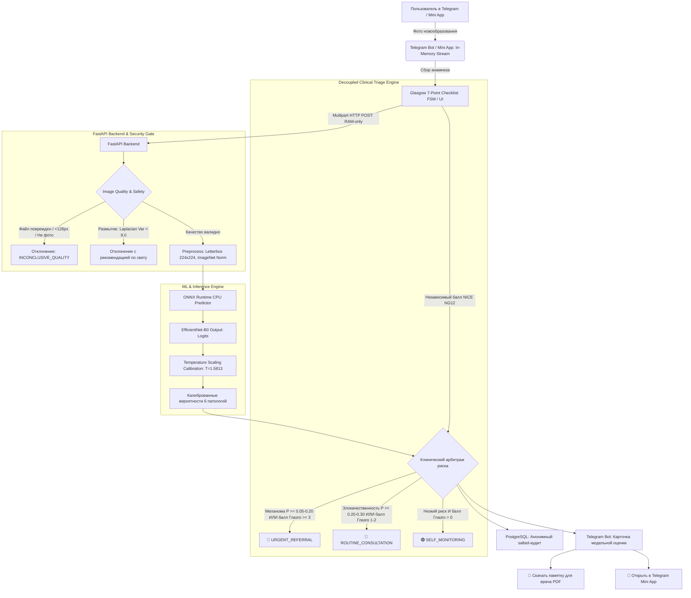

# SkinAI: Текущее состояние системы и отчёт для коллег
*Статус проекта: Готов к демонстрации и клинической апробации (Фазы 0–7 завершены) | Дата: Октябрь 2026*

---

## 1. Резюме для руководства и экспертов (Executive Summary)

**SkinAI** — это открытая, воспроизводимая исследовательская система для предварительного анализа изображений новообразований кожи. Система объединяет:
1. **Компьютерное зрение на базе сверточных нейросетей**: `EfficientNet-B0`, экспортированный в оптимизированный CPU-инференс ONNX Runtime с температурной калибровкой ($T = 1.5813$).
2. **Доказательный клинический опросник анамнеза**: 7-точечная шкала Глазго (Glasgow 7-Point Checklist), рекомендованная британским протоколом **NICE NG12**.
3. **Раздельный 4-уровневый клинический триаж (Decoupled Triage Engine)**: отказ от эвристического умножения вероятностей нейросети на баллы анамнеза в пользу клинически обоснованных уровней маршрутизации:
   - 🔴 **`URGENT_REFERRAL`** (*Приоритетный визит к дерматологу в течение 1–2 недель*);
   - 🔵 **`ROUTINE_CONSULTATION`** (*Плановый профилактический осмотр*);
   - 🟢 **`SELF_MONITORING`** (*Динамическое самонаблюдение*);
   - ⚪ **`INCONCLUSIVE_QUALITY`** (*Недостаточное качество снимка*).
4. **Генератор памятки для врача без когнитивного якорения (Zero Cognitive Anchoring)**: одностраничный in-memory PDF-документ для очного приёма (фото, дата, ответы Глазго, рекомендованные вопросы врачу, но **без** процентов нейросети).
5. **Трехъязычный Telegram-бот (`aiogram 3`)**: полная локализация диалогов, шкал и терминологии на трёх языках — **Русском**, **Английском** и **Корейском** (한국어).
6. **Интерактивный Telegram Mini App (Vite + TypeScript)**: карточка новообразования, прогресс-бар шкалы Глазго, обучающий справочник ABCD и клиентский экспорт памятки.
7. **Отказоустойчивый бэкенд на FastAPI**: микросервисная архитектура в Docker с базой данных PostgreSQL для сбора анонимной аналитики и `tmpfs`-буфером в RAM.
8. **Архитектура нулевого сохранения персональных данных (Zero Raw Image Retention)**: пользовательские фотографии обрабатываются исключительно в оперативной памяти (RAM) и удаляются немедленно после завершения сессии анализа.

> **Медицинский и юридический статус (Non-Claim Disclaimer)**:
> SkinAI — это экспериментальный исследовательский инструмент поддержки принятия решений. Система **не является медицинским изделием**, **не ставит диагнозы** и **не назначает лечение**. При любом результате анализа пользователю демонстрируется обязательная рекомендация очной консультации сертифицированного врача-дерматолога.

---

## 2. Как система работает прямо сейчас (End-to-End Pipeline)



### Пошаговый путь пользователя (User Journey):
1. **Старт и выбор языка**: Команда `/start` $\to$ выбор языка (🇷🇺 Русский / 🇬🇧 English / 🇰🇷 한국어) $\to$ обязательное принятие условий и предупреждения о недиагностическом характере сервиса.
2. **Загрузка фотографии**: Пользователь отправляет крупный план родинки со смартфона (поддерживаются форматы JPEG, PNG, WebP).
3. **Интерактивный опросник анамнеза (Шкала Глазго)**:
   - *Основные критерии (Major, по 2 балла)*: изменение размера/рост, изменение формы/неровные края, неоднородный цвет.
   - *Дополнительные критерии (Minor, по 1 баллу)*: диаметр $\ge 7$ мм, воспаление/покраснение вокруг, мокнутие/кровоточивость, зуд или изменение чувствительности.
   - Возможность ответить «Да», «Нет» или нажать «Пропустить опросник».
4. **Анализ нейросетью и калибровка**:
   - Оценка качества кадра: проверка разрешения, структуры файла и уровня размытия (Blur detection по дисперсии оператора Лапласа).
   - Расчёт распределения вероятностей по 6 клиническим классам (PAD-UFES-20).
   - Масштабирование температуры (Temperature Scaling, $T = 1.5813$), снижающее ошибку калибровки (ECE) с 14.24% до 5.49%.
5. **Результат и триаж**:
   - Пользователь получает спокойный и информативный ответ с уровнем маршрутизации (Срочный визит / Плановый осмотр / Самонаблюдение).
6. **Выдача памятки для врача (PDF Memo)**:
   - Одно нажатие кнопки генерирует документ для очного визита с фотографией, ответами опросника Глазго и вопросами к доктору без утечки процентов вероятности ИИ.

---

## 3. Доказательная база и валидация на отложенном тест-сете

| Параметр | Значение | Научное / методологическое обоснование |
|---|---|---|
| **Базовый датасет** | **PAD-UFES-20** (Collection 406) | Снимки получены на различные смартфоны в реальных амбулаторных условиях (Бразилия, Federal University of Espírito Santo). |
| **Лицензия данных** | **Creative Commons CC-BY 4.0** | Полная юридическая чистота для исследований и прикладных разработок с указанием авторства (`commercial_ok`). |
| **Объём выборки** | 2 298 изображений, 1 373 уникальных пациента | Реальные клинические снимки, включая сопутствующие метаданные. |
| **Принцип разделения (Split)** | **GroupKFold по `patient_id`** (70% Train, 15% Val, 15% Test) | **Нулевая утечка пациентов (Zero Patient Leakage)**: все снимки одного и того же человека находятся строго в одном сплите. |
| **Размер отложенного тест-сета** | **346 снимков, 205 пациентов** | Не участвовал в обучении, подборе гиперпараметров или калибровке. |
| **Дискриминантная способность** | **Macro ROC-AUC: 0.8552** | Высокая разделяющая способность моделей по всем 6 классам независимо от порога. |
| **Калибровка (ECE)** | **5.49%** (снижение с 14.24%, улучшение на 61.4%) | Температурное масштабирование $T=1.5813$ приводит выдаваемые вероятности к реальной частоте патологий. |
| **Чувствительность по меланоме** | **75.0%** при пороге $\tau_{\text{mel}} = 0.05$ (специфичность **87.3%**) | Решение проблемы подавления редкого класса мажоритарными классами при наивном `argmax` (где recall был всего 25%). |
| **Чувствительность по злокачественной группе** | **95.68%** при пороге $\tau_{\text{mal}} = 0.20$ | Пропуск рака (`bcc`+`scc`+`mel`) снижен с 21.0% (при наивном `argmax`) до **4.32%**. |

---

## 4. Архитектура и структура репозитория

```text
SkinAI Workspace
├── artifacts/
│   ├── benchmarks/ (5fold_cv_results.json, clinical_validation_results.json)
│   └── models/smartphone_clinical/
│       ├── model.onnx (16.0 MB, SHA-256 проверен)
│       └── manifest.yaml (параметры нормализации, классы, пороги)
├── backend/app/
│   ├── api/v1/endpoints/ (health, profiles, predict)
│   ├── core/ (config, pydantic settings, secrets)
│   ├── db/ (SQLAlchemy 2 models, anonymous telemetry)
│   └── services/ (image validator, blur detection)
├── bot/
│   ├── handlers/ (analysis, common dialogs, FSM states)
│   ├── keyboards/ (inline menus, Glasgow checklist, language selector)
│   ├── locales/ (ru.json, en.json, ko.json — 100% паритет ключей)
│   └── services/ (pdf_report.py — многоязычный генератор памятки)
├── miniapp/ (Telegram Mini App: Vite + TypeScript + CSS)
│   ├── src/ (компоненты триажа, ABCD-гайд, переключатель кейсов, локализация)
│   └── dist/ (готовый оптимизированный production-бандл)
├── deploy/
│   ├── Dockerfile.api (CPU-optimized, non-root user, tmpfs RAM)
│   ├── Dockerfile.bot (aiogram 3 polling, TrueType-шрифты Nanum и DejaVu)
│   ├── docker-compose.prod.yml (полный стек: Nginx, API, DB, Bot)
│   └── nginx.conf (Reverse proxy: SSL, rate limit 10 r/s, 15MB cap)
├── ml/
│   ├── anamnesis/ (шкала Глазго NICE NG12, 4-уровневый клинический триаж)
│   ├── datasets/ (загрузка, валидация, сплит без утечек)
│   ├── inference/ (канонический OnnxPredictor, T-scaling)
│   └── training/ (обучение, аугментация, экспорт)
└── tests/
    ├── api/, bot/, unit/, integration/
    └── security/ (14 тестов на устойчивость, фаззинг, декомпрессионные бомбы)
```

- **Инференс**: ONNX Runtime (CPU), среднее время инференса кадра на обычном серверном процессоре составляет **40–70 мс**.
- **Безопасность (STRIDE Threat Model)**:
  - Ограничение размера файлов: строго до 15 МБ.
  - Защита от Decompression Bombs: лимит Pillow `MAX_IMAGE_PIXELS = 25 000 000`.
  - Защита от полиглотов и вредоносных файлов: проверка magic bytes (только валидные сигнатуры JPEG, PNG, WebP; PE/ELF/SVG-скрипты мгновенно отсекаются).
  - Телеметрия: сохраняются только хеш клиента с криптографической солью (`HMAC-SHA256(user_id, TELEMETRY_SALT)`), время отклика и уровень триажа. **Сырые фотографии не попадают в БД и не пишутся на диск**.
- **Тестовое покрытие**: **74 автоматических теста** (`pytest`), линтер `Ruff` — 0 замечаний.

---

## 5. Итоги экспертного консилиума (Резолюция коллег)

В ходе внутреннего консилиума были детально проанализированы отзывы и предложения 5 профильных систем: **Claude**, **ChatGPT**, **Gemini**, **DeepSeek**, **Grok**.

| Эксперт / Роль | Ключевой вклад | Статус реализации в коде |
|---|---|---|
| **Claude** (Клинический риск-инженер) | Предостерег от эвристического умножения вероятностей ИИ на баллы анамнеза (проблема псевдо-байесовского искажения). | **Реализовано (P0)**: Внедрен раздельный 4-уровневый арбитраж клинического триажа. |
| **ChatGPT** (Продуктовый архитектор) | Предложил памятку для очного визита к врачу без указания процентов вероятностей нейросети, чтобы избежать когнитивного якорения доктора. | **Реализовано (P1)**: Создан `bot/services/pdf_report.py` с нулевым когнитивным якорением. |
| **Gemini** (ML & Data Governance) | Настоял на расчете ECE до и после калибровки и сканировании порогов чувствительности по меланоме вместо наивного `argmax`. | **Реализовано (Phase 2.5)**: Рассчитаны ECE (5.49%) и кривые отсечки $\tau \in [0.02, 0.50]$. |
| **DeepSeek** (Системный инженер) | Рекомендовал `tmpfs` в RAM для буфера изображений и fail-closed allowlist для закрытого тестирования. | **Реализовано (P0/Phase 6)**: Настроен `tmpfs: /tmp:size=2G` и `TELEGRAM_ALLOWED_USERS`. |
| **Grok** (UX & Product Specialist) | Предложил Telegram Mini App для наглядного объяснения пациентам признаков ABCD и динамической шкалы Глазго. | **Реализовано (Phase 7)**: Создан `miniapp/` (Vite + TypeScript) с поддержкой RU/EN/KO. |

---

## 6. Текущие ограничения и вектор дальнейшего развития

1. **Закрытый мир классов (Closed-World Assumption)**:
   - Модель обучена на 6 классах кожных новообразований. На следующем этапе планируется интеграция детектора первой ступени «Кожа / Не кожа / Здоровая кожа».
2. **Зависимость от фокусировки смартфона**:
   - Встроенный фильтр Лапласа отсекает нерезкие кадры, но для прецизионной микроструктурной оценки рекомендуется дерматоскопия.
3. **Расширение выборки меланомы**:
   - Для промышленного релиза планируется подключение разрешенных по лицензии (`CC-0` / `CC-BY`) архивов ISIC 2019/2020.
