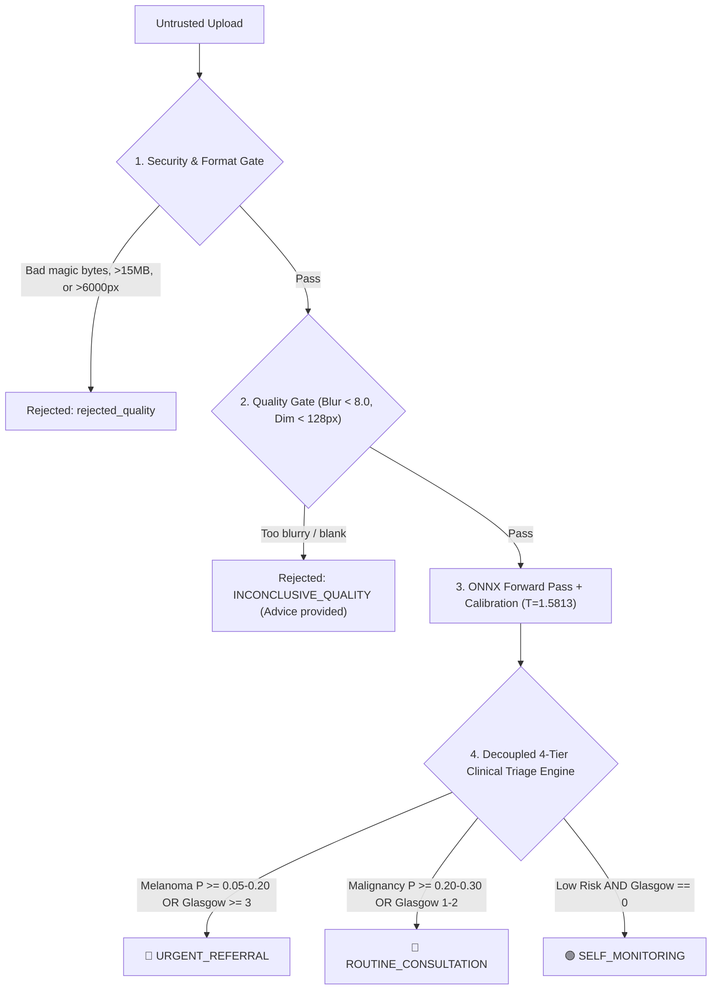

# SkinAI Security, Privacy & Safety Architecture

## 1. Executive Summary
SkinAI is an open-source, reproducible, research-oriented skin lesion image analysis system. Because it processes untrusted user uploads and handles sensitive health-adjacent telemetry, it is engineered with a **Defense-in-Depth** security architecture, a **Zero Raw Data Retention** privacy model, and a **Fail-Closed Clinical Triage Engine**.

---

## 2. Threat Model (STRIDE Matrix)

| Threat Category | Potential Risk in SkinAI | Defense Mechanism | Verification Test |
|---|---|---|---|
| **Spoofing** | Attacker uploads executables (PE, ELF) or script polyglots disguised as JPEG/PNG | Strict magic byte verification (`detect_image_format_from_bytes`), Pillow file verification stream check | `test_executable_pe_binary_rejection`, `test_svg_script_injection_rejection` |
| **Tampering** | Model weights or manifests modified in transit or deployment | SHA-256 integrity hash verified against `manifest.yaml` upon OnnxPredictor initialization | `test_onnx_predictor_with_bundle` |
| **Repudiation** | Client actions cannot be verified; audits contested | Ephemeral UUID `request_id` generated per request; logged with UTC timestamp and salted client hash | `test_audit_log_written_to_database` |
| **Information Disclosure** | Leakage of patient face/lesion photos, bot tokens, or database secrets | **Zero user photo retention**: images processed purely in RAM (`io.BytesIO`); salted SHA-256 client hashing; error sanitization prevents internal path leaks | `test_zero_raw_photo_retention_in_database`, `test_secret_sanitization_in_responses` |
| **Denial of Service** | Decompression bombs (e.g. 50k x 50k pixel files) causing Out-Of-Memory (OOM) | Pillow `MAX_IMAGE_PIXELS = 25_000_000`, `MAX_IMAGE_DIMENSION = 6000`, `MAX_UPLOAD_SIZE_BYTES = 15 MB` | `test_decompression_bomb_rejection`, `test_oversized_payload_rejection` |
| **Elevation of Privilege** | Container escape or unauthorized host access | Container runs as non-privileged non-root user `skinai:skinai` (UID 1000) with readonly rootfs where feasible | `deploy/Dockerfile.api`, `deploy/Dockerfile.bot` |

---

## 3. Privacy & Data Protection Architecture

### 3.1 Zero Raw Photo Retention
- **Policy**: SkinAI **never** saves raw user photos to persistent disk or databases.
- **In-Memory Lifecycle**:
  1. Telegram Bot downloads file into an in-memory buffer (`io.BytesIO`).
  2. Buffer is streamed over HTTP to the FastAPI `/v1/predict` endpoint.
  3. FastAPI parses and validates the image in RAM.
  4. Once prediction completes, the byte buffer is freed by the garbage collector.
  5. The PostgreSQL/SQLite database records only: `request_id`, `created_at`, `client_hash`, `profile`, `status`, `predicted_class`, `confidence`, `melanoma_risk_score`, `referral_recommended`, and `latency_ms`.

### 3.2 Client Identity Anonymization
- Telegram user IDs and IP addresses are never logged in plaintext.
- They are hashed using SHA-256 with a private secret salt (`TELEMETRY_SALT`):
  $$\text{client\_hash} = \text{SHA256}(\text{identifier} + \text{salt})[:32]$$
- This allows tracking aggregate service reliability without identifying individual users.

### 3.3 Zero Cognitive Anchoring in Doctor Clinical Memos
- To prevent AI anchoring bias during subsequent in-person dermoscopy consultations, generated PDF clinical encounter memos (`bot/services/pdf_report.py`) strictly omit raw model softmax percentages and AI disease assertions.
- The memo presents solely: the photograph, encounter UUID, timestamp, patient Glasgow 7-point checklist responses, suggested consultation questions, and regulatory disclaimer.

---

## 4. Medical Safety & Abstention Engine

### 4.1 Non-Diagnostic Legal Framing
- All outputs are labelled as **«Модельная оценка»** / **«Model score»** / **«모델 평가»**, never **«Диагноз»** / **«Diagnosis»** / **«진단»**.
- Mandatory static disclaimers are returned in Russian, English, and Korean on every single response payload:
  > *SkinAI является исследовательским инструментом предварительного анализа и не заменяет очный визит к врачу-дерматологу.*

### 4.2 Multi-Gate Abstention Pipeline

---

## 5. Dependency Audit, Access Control & Container Security

### 5.1 Docker Isolation & Non-Root Execution
- `deploy/Dockerfile.api` and `deploy/Dockerfile.bot` both build from official `python:3.11-slim`.
- Security hardening includes non-root user `skinai` (UID 1000) and strict `HEALTHCHECK` probes.

### 5.2 Ephemeral RAM Storage via `tmpfs`
- In `deploy/docker-compose.prod.yml`, the `/tmp` directory is mounted via tmpfs (`tmpfs: /tmp:size=2G,mode=1777`).
- Prevents temporary files, OS swap buffers, or decrypted memory streams from writing image remnants to physical disk.

### 5.3 Fail-Closed Access Control Allowlist
- For staging and clinical validation, the Telegram Bot implements a fail-closed user allowlist (`TELEGRAM_ALLOWED_USERS`).
- If enabled, non-whitelisted users receive a polite access notification, preventing unvetted public ingestion during closed testing.

### 5.4 Secrets Hygiene
- Secrets (`TELEGRAM_BOT_TOKEN`, `API_SECRET_KEY`, `TELEMETRY_SALT`, `POSTGRES_PASSWORD`) reside solely in `.env`, which is strictly excluded from version control via `.gitignore`.
